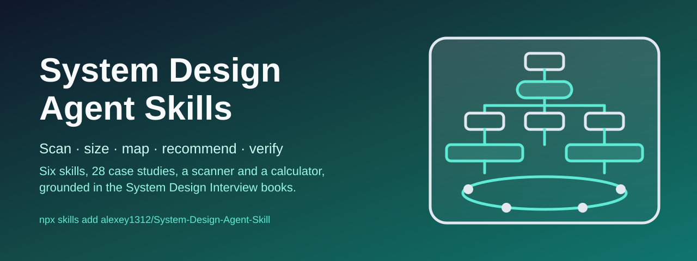

<p align="center">
  
</p>

# System Design Agent Skills

[](https://github.com/alexey1312/System-Design-Agent-Skill/actions/workflows/validate.yml)
[](LICENSE)
[](https://github.com/alexey1312/System-Design-Agent-Skill/releases)
[](https://github.com/alexey1312/System-Design-Agent-Skill/stargazers)

**Six coordinated Agent Skills that act as a system design reference and
assistant on real projects** —
scan a codebase for the stores, queues, caches and transports it runs,
check them against a chapter-backed review checklist,
size the next 10× with a deterministic calculator,
and write design documents and review recommendations with trade-offs —
grounded in all 28 case studies of the *System Design Interview* books.
They work in any AI coding tool that supports the
[Agent Skills open format](https://agentskills.io/home).

The skills turn Alex Xu's *System Design Interview – An Insider's Guide*
(Vol. 1) and *Volume 2* (with Sahn Lam), as summarised in the
[system-design-notes](https://github.com/liquidslr/system-design-notes)
repository, into a repeatable workflow for real systems:
read what the project already runs, establish the numbers,
map every part to the chapter that treats it,
offer options with their costs, recommend, and say how to verify.
Interview preparation is included as a mode, not the point.

## Who this is for

- Teams designing a new service or a change
  who want a design document with options, trade-offs and numbers
- Engineers reviewing an existing backend before growth, a migration
  or an incident post-mortem, who want every recommendation tied to a
  known pattern and a way to verify it
- Anyone who needs QPS, storage, bandwidth and server estimates
  shown with their assumptions instead of asserted
- Engineers preparing for system design interviews, as a secondary mode

## What it does on a real project

- **Scans the code** — a read-only script reports the databases, caches,
  queues, search indexes, object storage, CDN, metrics, WebSocket,
  push, payment and geo libraries the project uses, with `file:line`
  evidence, and flags code patterns the books warn about:
  money in floats, `hash % N` placement, `SELECT … FOR UPDATE`,
  timestamp-based optimistic locks, rank-by-`COUNT(*)`
- **Asks the right questions** — generated from the inventory:
  what the cache loses on restart, which delivery semantics consumers
  assume, which idempotency key reaches the payment provider
- **Walks a review checklist** — 45 checks in nine groups
  (availability, data stores, caches, queues, money and inventory,
  real-time, rate limiting, streams, operations), each citing its chapter
- **Establishes the numbers** — production metrics when the owner has
  them, otherwise a calculator that turns DAU and payload sizes into QPS,
  storage, bandwidth, cache and server counts, with derivations
- **Writes the document** — options with a trade-off table, the
  recommended design, rollout and verification, risks and open questions;
  in a review, recommendations with stable IDs and statuses
  (`proposed`, `accepted`, `declined`, `kept`, `needs-data`)
- **Respects deliberate decisions** — a documented choice that
  contradicts a chapter is reported as *kept*, not rewritten

Every automated check is listed with its source in
[DESIGN-CHECKS.md](DESIGN-CHECKS.md);
the chapter-to-skill map is in [references/sources.md](references/sources.md).

## What it knows

- **Building blocks** — the scaling ladder from a single server to
  sharded, multi-data-center systems, a pattern index across all chapters,
  and a store-selection table
- **Infrastructure** — rate limiter, consistent hashing, key-value store,
  unique ID generator, distributed message queue, object storage,
  metrics monitoring and alerting
- **Content platforms** — URL shortener, web crawler, news feed,
  search autocomplete, video streaming, cloud file storage
- **Real-time and messaging** — notification system, chat, email,
  gaming leaderboard, ad click aggregation
- **Geospatial** — proximity service, nearby friends, maps and navigation
- **Transactions** — hotel reservation, payment system, digital wallet,
  stock exchange
- **Estimation** — powers of two, latency numbers, availability nines,
  the worked examples
- **The interview framework** — four steps, time budget, questions to ask,
  dos and don'ts, how to run a mock

## Context before boxes

A design answer that starts with a diagram is guessing.
The skills treat "design X" or "review this" as permission to read and ask,
not to draw.

Before any architecture, you get:

- The inventory of what the project already runs, with evidence
- Requirements, non-functional targets, what was left out,
  and every assumption written down where you can challenge it
- An estimate table with its derivation, from metrics or the calculator
- The chapter each pattern comes from, or the label *inference*

Then options, the recommendation, the deep dives that carry the risk,
and a section on rollout, verification and what was not verified.
Nothing in the project is edited; recommendations are applied only
after you accept them by ID.

## How it works

Unlike text-only skills, this repository ships two read-only Python scripts,
so your agent reasons over structured output instead of ad-hoc grep.

**When it triggers:**

- You ask how to design, scale, fix or review a service or architecture.
- You ask which store, cache, queue, index or pattern to use, or what
  breaks at 10×.
- You need QPS, storage, bandwidth, cache or server estimates.
- You name one of the 28 systems, or a pattern from them:
  fan-out, geohash, consistent hashing, quorum, idempotency key, Saga,
  event sourcing, sequencer.
- You ask for a mock system design interview or feedback on your answer.

**What you can ask:**

- `Review this repo for design problems before we grow 10x. Don't change anything.`
- `Should we put Redis in front of the orders table or add read replicas?`
- `We have 2M DAU uploading 3 photos a day. What breaks first when we double?`
- `Token bucket or sliding window for our API gateway? We must allow bursts.`
- `Two users keep booking the last room. Fix the data model and the locking.`
- `Write a design doc for moving our cron-based exports to a queue with workers.`
- `Be my interviewer. Pick a problem and push back on my choices.`

**Under the hood:**

- `scripts/arch_scan.py` — walks the project (skipping dependencies and
  hidden directories), reads manifests, Docker Compose, Kubernetes,
  Terraform, `.env` files and import lines, and emits JSON or Markdown:
  the technology inventory with evidence, findings with stable IDs and
  chapter citations, questions for the owners, and the references to load.
  Never writes.
- `scripts/estimate.py` — turns DAU and actions per day, an event count
  or a QPS figure, plus payload and served sizes, read/write ratio, peak
  factor and retention into QPS, storage, bandwidth (average and peak),
  egress cost, metadata rows, cache size and server count, as JSON or a
  Markdown table with derivations; sizes tables and key spaces; also the latency and powers-of-two tables and the
  downtime behind any availability figure.
  Never writes.
- `references/` — five shared references (sources, estimation cheat
  sheet, design and review format, building blocks, review checklist)
  copied into every skill, and one condensed reference per chapter inside
  the skill that owns it.
- `skills/*/evals/` — skill-creator evals (with a fixture project for the
  review flow) and trigger queries for each skill.

## The skills

| Skill | What it does |
| --- | --- |
| [`system-design-advisor`](skills/system-design-advisor/SKILL.md) | Orchestrator: scan, numbers, chapter mapping, options and recommendation, rollout; design documents; reviews; capacity planning; interview practice; routes to specialists |
| [`system-design-infrastructure`](skills/system-design-infrastructure/SKILL.md) | Rate limiter, consistent hashing, key-value store, unique ID generator, distributed message queue, object storage, metrics monitoring |
| [`system-design-content-platforms`](skills/system-design-content-platforms/SKILL.md) | URL shortener, web crawler, news feed, search autocomplete, video streaming, cloud file storage |
| [`system-design-realtime-messaging`](skills/system-design-realtime-messaging/SKILL.md) | Notification system, chat, email, gaming leaderboard, ad click aggregation |
| [`system-design-geospatial`](skills/system-design-geospatial/SKILL.md) | Proximity service, nearby friends, maps and navigation |
| [`system-design-transactions`](skills/system-design-transactions/SKILL.md) | Hotel reservation, payment system, digital wallet, stock exchange |

Start with `system-design-advisor` for a project or a design question;
call a specialist directly for a focused one.
Every skill carries its own copy of the shared references and both scripts,
so any subset installs cleanly.

## How to Use These Skills

### Option A: Using skills.sh

Install all six with a single command:

```bash
npx skills add https://github.com/alexey1312/System-Design-Agent-Skill
```

Or just one:

```bash
npx skills add https://github.com/alexey1312/System-Design-Agent-Skill --skill system-design-transactions
```

Then use it in your AI agent, for example:

> Use the system design advisor skill and review this service before we scale.

### Option B: Claude Code Plugin

#### Personal Usage

1. Add the marketplace:

```bash
/plugin marketplace add alexey1312/System-Design-Agent-Skill
```

2. Install the plugin:

```bash
/plugin install system-design-skills@system-design-skills
```

#### Project Configuration

To provide the skills to everyone working in a repository,
configure the repository's `.claude/settings.json`:

```json
{
  "enabledPlugins": {
    "system-design-skills@system-design-skills": true
  },
  "extraKnownMarketplaces": {
    "system-design-skills": {
      "source": {
        "source": "github",
        "repo": "alexey1312/System-Design-Agent-Skill"
      }
    }
  }
}
```

When team members open the project, Claude Code will prompt them to install the plugin.

### Option C: Codex / OpenAI-compatible tools

This repository includes an `agents/openai.yaml` manifest.
Copy or symlink the skill folders into your Codex skills directory:

```bash
cp -R skills/system-design-* "$CODEX_HOME/skills/"
```

See the [Codex skills documentation](https://developers.openai.com/codex/skills/)
for details on where to save skills.

### Option D: Using pi package manager

Install via [pi](https://github.com/badlogic/pi-mono):

```bash
pi install https://github.com/alexey1312/System-Design-Agent-Skill
```

### Option E: Manual install

1. **Clone** this repository.
2. **Install or symlink** the folders under `skills/` following your tool's
   official skills installation docs (see links below).
3. **Ask your AI tool** to use the `system-design-advisor` skill on your project.

Or download a single `.skill` archive from the
[latest release](https://github.com/alexey1312/System-Design-Agent-Skill/releases/latest).

#### Where to Save Skills

- **Codex:** [Where to save skills](https://developers.openai.com/codex/skills/#where-to-save-skills)
- **Claude:** [Using Skills](https://docs.claude.com/en/docs/agents-and-tools/agent-skills/overview)
- **Cursor:** [Enabling Skills](https://cursor.com/docs/context/skills#enabling-skills)

**How to verify:**

Ask for a review of a project.
Your agent should run the bundled scan and report the inventory with
`file:line` evidence, ask the generated questions or state assumptions,
show the calculator's table for the numbers,
cite a volume and chapter for each pattern,
give every recommendation an ID and a status,
and edit nothing.

## Skill Structure

```text
skills/
  system-design-advisor/            Orchestrator: scan, numbers, mapping, options, rollout
    references/framework.md         Vol. 1 ch. 3 (interview mode)
    evals/files/Checkout/           Fixture project for the review eval
  system-design-infrastructure/     + rate-limiter, consistent-hashing, key-value-store,
                                      unique-id-generator, distributed-message-queue,
                                      object-storage, metrics-monitoring
  system-design-content-platforms/  + url-shortener, web-crawler, news-feed,
                                      search-autocomplete, video-streaming, cloud-file-storage
  system-design-realtime-messaging/ + notification-system, chat-system, email-service,
                                      gaming-leaderboard, ad-click-aggregation
  system-design-geospatial/         + proximity-service, nearby-friends, maps-navigation
  system-design-transactions/       + hotel-reservation, payment-system, digital-wallet,
                                      stock-exchange
    SKILL.md                        Workflow and rules for the skill
    references/                     sources, estimation-cheatsheet, design-format,
                                    building-blocks, review-checklist (shared copies)
                                    + the case studies above
    scripts/                        arch_scan.py, estimate.py (shared copies)
    evals/                          skill-creator evals and trigger queries
references/                         Canonical shared references
scripts/                            Canonical scripts, sync_skill_copies.py, package_skills.py
tests/                              Deterministic unit tests
DESIGN-CHECKS.md                    Every automated check, with sources
```

## This skill's approach

- **Grounded**: every pattern cites a volume and chapter;
  anything else is labelled as inference.
- **Evidence first**: the scan reports `file:line`, the calculator shows
  its derivation, and a recommendation without a verification step is
  marked as not verified.
- **Scale-honest**: ten transactions per second gets a relational database
  and a unique constraint, not a sharding plan.
- **Token efficient**: one scan returns a compact inventory instead of
  dozens of exploratory searches, and each case-study reference loads
  only when that system is in play.
- **Respectful of your decisions**: documented, deliberate choices are
  reported as *kept*, not rewritten.
- **Read-only by design**: both scripts never write; recommendations are
  applied only after you accept them by ID.

## Sources

- *System Design Interview – An Insider's Guide* (Alex Xu, 2020) — Vol. 1, chapters 1–15
- *System Design Interview – An Insider's Guide: Volume 2* (Alex Xu, Sahn Lam, 2022) — chapters 1–13
- [liquidslr/system-design-notes](https://github.com/liquidslr/system-design-notes) —
  the community notes these references condense;
  they carry no licence, so nothing here is quoted and no figure is copied
- [ByteByteGo](https://bytebytego.com/courses/system-design-interview) — the authors' course version of the same material

Chapter-level map and further reading: [references/sources.md](references/sources.md).

## Contributing

Contributions are welcome — especially scanner detections and rules found
on real projects, false positives with a minimal reproduction,
corrections to a case study, and dated facts that have moved since the
books were written.
Please read [CONTRIBUTING.md](CONTRIBUTING.md).

## About the author

Created by [Aleksei Kakoulin](https://github.com/alexey1312).
Packaging follows the
[iPhone Duo Agent Skills](https://github.com/alexey1312/iPhone-Duo-Agent-Skill)
and Antoine van der Lee's
[Xcode Build Optimization](https://github.com/AvdLee/Xcode-Build-Optimization-Agent-Skill)
Agent Skills.
The system design material is Alex Xu's and Sahn Lam's;
this project is not affiliated with them or with ByteByteGo.

## License

This project is open-source and available under the MIT License.
See [LICENSE](LICENSE) for details.
